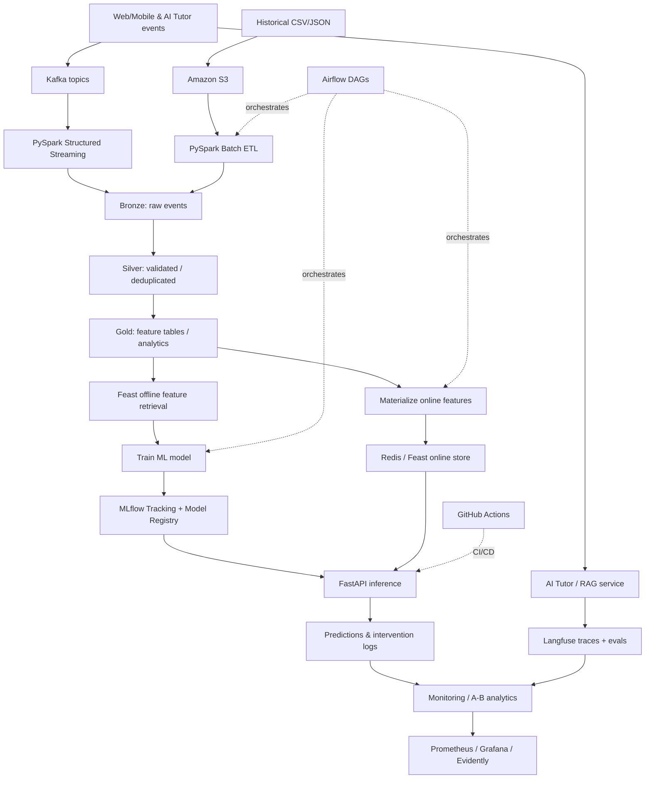

# SPARK → MLOps & LLMOps: END-TO-END PROJECT ROADMAP

> **Project:** EduPulse — Real-time Learning Analytics, Churn Prediction & AI Tutor Operations Platform  
> **Audience:** AI Engineer đã biết Python, FastAPI, RAG/LLM; bắt đầu Apache Spark từ số 0.  
> **Duration:** 12 tuần (gợi ý 10–15 giờ/tuần).  
> **Goal:** Có một project GitHub chạy được từ local, có tài liệu, test, metrics và demo production-like.

---

## 1. Mục tiêu học tập

Sau project này, bạn có thể:

1. Giải thích **Spark là gì**, Spark Driver/Executor, lazy evaluation, partitions, transformations/actions, jobs/stages/tasks, shuffle và Spark UI.
2. Viết ETL batch với **PySpark DataFrame & Spark SQL**; xử lý dữ liệu lỗi, joins, windows, aggregations, deduplication, data skew, memory và performance tuning.
3. Xử lý sự kiện realtime với **Kafka + Spark Structured Streaming**, watermark, event time, checkpointing, recovery và idempotent sinks.
4. Thiết kế data lake theo **Bronze/Silver/Gold** dùng Parquet, rồi nâng cấp Delta Lake (ACID, merge/upsert, schema evolution, time travel nếu phiên bản hỗ trợ).
5. Xây dựng **features** từ lịch sử học tập và tránh training-serving skew / data leakage.
6. Train, evaluate, register và deploy một ML model với **MLflow + FastAPI**; giữ model, data, code, features ở các version có thể truy vết.
7. Thực hiện **A/B testing, canary rollout, rollback**, theo dõi chất lượng model, drift, latency và business outcomes.
8. Vận hành **LLMOps** cho AI Tutor: prompt versioning, eval, groundedness/hallucination proxy, tokens, cost, latency, traces.
9. Orchestrate bằng **Airflow**, containerize bằng Docker, build CI/CD, dashboard metrics và cảnh báo sự cố.
10. Trình bày kiến trúc, trade-offs, lỗi production và lý do chọn công nghệ trong phỏng vấn MLOps / AI Engineer.

**Lưu ý quan trọng:** Spark là engine xử lý dữ liệu phân tán, **không phải** công cụ serving model realtime. Dùng Spark để chuẩn bị features, training data, batch scoring và streaming aggregations; dùng FastAPI và một online feature store cho low-latency inference.

---

## 2. Bài toán thực tế: EduPulse

Một nền tảng học tiếng Anh có học viên xem video, làm quiz, học từ vựng, chat với AI Tutor và đánh giá câu trả lời.

### 2.1. Business problems

- **Learning analytics:** Biết số phút học, số buổi học, quiz accuracy, tỷ lệ hoàn thành video, số lần hỏi AI Tutor theo ngày / tuần / cohort.
- **Churn / disengagement prediction:** Dự báo học viên có khả năng *không hoạt động trong 7 ngày tiếp theo*, để gửi nhắc học hoặc bài học phù hợp.
- **Personalized interventions:** Từ feature gần nhất, FastAPI trả về risk score + recommendation rule đơn giản.
- **AI Tutor quality:** Theo dõi groundedness, tỷ lệ câu trả lời không đủ căn cứ, feedback tiêu cực, token cost, độ trễ P95 và lỗi.
- **Business impact:** Thí nghiệm A/B xem intervention có tăng tỷ lệ quay lại học hay không.

### 2.2. Data contracts tối thiểu

**`learning_events`**

| Field | Type | Example |
|---|---|---|
| `event_id` | string | `evt_00001` |
| `student_id` | string | `stu_001` |
| `event_type` | string | `video_started`, `video_completed`, `quiz_submitted`, `session_ended` |
| `event_time` | timestamp | UTC timestamp |
| `ingest_time` | timestamp | UTC timestamp |
| `video_id` | string nullable | `vid_42` |
| `duration_sec` | integer nullable | `420` |
| `quiz_score` | float nullable | `0.8` |
| `metadata` | JSON/map | `{"device": "mobile"}` |

**`tutor_interactions`**

| Field | Type | Notes |
|---|---|---|
| `interaction_id` | string | ID duy nhất |
| `student_id` | string | FK học viên |
| `timestamp` | timestamp | UTC |
| `prompt_version` | string | ví dụ `tutor_v3` |
| `model_name` | string | LLM được gọi |
| `retrieval_doc_ids` | array<string> | IDs tài liệu grounding |
| `input_tokens`, `output_tokens` | integer | consumption |
| `latency_ms` | integer | end-to-end |
| `estimated_cost_usd` | float | theo bảng giá cấu hình |
| `user_rating` | integer nullable | feedback 1–5 |
| `eval_groundedness` | float nullable | evaluator score |

**`students`**: `student_id`, `signup_at`, `country`, `level`, `plan_type` (synthetic, không dùng PII).  
**`interventions`**: `student_id`, `experiment_id`, `variant`, `assigned_at`, `delivered_at`.  
**`outcomes`**: `student_id`, `returned_7d`, `observed_until`.

### 2.3. Tạo dữ liệu

- Giai đoạn đầu: tạo **100.000–500.000 events** bằng Python/Faker, có seed cố định để tái lập.
- Trung cấp: **1–5 triệu events** lưu Parquet để học partitions, joins và shuffle.
- Nâng cao: Kafka producer tạo **50–300 events/giây** trong thử nghiệm local, tùy máy.
- Chủ động inject: duplicate events, null fields, invalid scores, late events, out-of-order timestamps, skewed students, schema change.
- Tất cả số liệu là **mục tiêu benchmark hoặc dữ liệu mô phỏng**, không phải thành tích đã đo.

### 2.4. Định nghĩa target tránh leakage

Với snapshot ở ngày **T**: features chỉ lấy từ sự kiện xảy ra **trước hoặc tại T**, nhãn `inactive_next_7d = 1` nếu không có learning activity trong `(T, T+7d]`. Chỉ train trên các snapshot có ít nhất 7 ngày quan sát tương lai. Tách train/validation/test **theo thời gian**, không random chia event của cùng kỳ quan sát để tránh leakage. Đánh giá thêm theo student cohort.

---

## 3. Kiến trúc mục tiêu



**Phân biệt responsibility:**

- **Kafka:** nhận / lưu tạm stream theo topic, partition, offset; không phải data lake.
- **Spark:** distributed compute cho batch/stream, feature engineering, aggregation.
- **Amazon S3:** AWS managed object storage cho data lake; **Parquet/Delta:** định dạng / table layer của data lake. Spark truy cập S3 qua `s3a://` và Hadoop S3A connector tương thích phiên bản Spark/Hadoop.
- **Airflow:** scheduler/orchestrator, không thay thế Spark compute.
- **Feast:** quản lý feature definitions, point-in-time historical retrieval và online retrieval. Bắt đầu bằng Parquet file offline + SQLite online ở local; nâng cấp Redis sau. Spark offline store / provider tích hợp có thể là community integration, cần kiểm tra compatibility khi chọn version.
- **MLflow:** tracking, artifacts, model registry và deployment aliases, không chạy ETL thay Spark.
- **FastAPI:** serving API với schema validation, metrics, rollout logic.
- **Langfuse:** tracing/eval/prompt operations cho AI Tutor; **Prometheus/Grafana:** operational metrics + dashboards.

### 3.1. Thiết lập AWS S3 cho dự án (thay MinIO)

- Tạo **một bucket riêng** với prefix `bronze/`, `silver/`, `gold/`, `mlflow-artifacts/`, `checkpoints/` (có thể tách bucket theo môi trường sau này). Bật Block Public Access và mã hóa mặc định; chọn cùng AWS Region cho tài nguyên liên quan.
- Cấp quyền theo **IAM least privilege** cho các prefix cần thiết. Khi chạy Spark trên laptop, ưu tiên AWS CLI profile / IAM Identity Center với thông tin xác thực tạm thời; khi triển khai trên AWS, dùng IAM role. **Không hardcode access key** vào code hoặc commit Git.
- Cấu hình **Hadoop S3A** (`s3a://bucket/key`) với dependency `hadoop-aws` tương thích Spark/Hadoop. Test thao tác đọc/ghi Parquet trước khi thêm Delta Lake. Kiểm tra tương thích Delta Lake với S3 và cơ chế commit/concurrent writes trước khi triển khai nhiều Spark writers.
- MLflow: PostgreSQL làm backend metadata store; S3 làm artifact store. `MLFLOW_S3_ENDPOINT_URL` không cần đặt nếu dùng trực tiếp AWS S3 thông thường.
- Thiết lập **AWS Budgets**, cảnh báo chi phí, bucket lifecycle và dọn checkpoint/artifact không còn cần thiết; lưu ý S3 requests, storage, network transfer, Kafka/EMR/Glue đều có thể tính phí.
- Chỉ cần Spark chạy local bằng Docker trong giai đoạn đầu. **Amazon EMR, AWS Glue và SageMaker là tùy chọn nâng cao**, không phải điều kiện để học PySpark/MLOps.

**Ví dụ layout:**

```text
s3://<your-bucket>/bronze/learning_events/
s3://<your-bucket>/silver/learning_events/
s3://<your-bucket>/gold/student_features/
s3://<your-bucket>/checkpoints/learning_events/
s3://<your-bucket>/mlflow-artifacts/
```

---

## 4. Danh mục công nghệ và thứ tự học

| Layer | Công nghệ | Vai trò | Mức độ |
|---|---|---|---|
| Language | Python 3.11+/SQL | ETL, jobs, service | Bắt buộc |
| Distributed data | Apache Spark / PySpark | Batch, SQL, streaming | **Trọng tâm** |
| Message ingestion | Apache Kafka | Real-time event pipeline | Trung cấp |
| Storage | Amazon S3 + Parquet | AWS object storage cho Bronze/Silver/Gold | Bắt buộc |
| Lakehouse | Delta Lake | Merge/upsert, schema enforcement | Nâng cao |
| Data validation | Pandera hoặc Great Expectations | Data quality checks | Trung cấp |
| Orchestration | Apache Airflow | DAGs, retries, schedules | Bắt buộc |
| Training | Scikit-learn / XGBoost | Churn classifier | Bắt buộc |
| Distributed ML | Spark MLlib | Pipeline + distributed baseline | Nâng cao |
| Tracking/Registry | MLflow + PostgreSQL + Amazon S3 | Experiments, models, artifacts | Bắt buộc |
| Feature Store | Feast + Parquet/SQLite, sau đó Redis | Offline/online features | Trung cấp |
| Serving | FastAPI + Pydantic | REST inference | Bắt buộc |
| LLM app | LangChain / RAG + model API | AI Tutor | Nâng cao (tái sử dụng kinh nghiệm sẵn có) |
| LLM observability | Langfuse | Trace, prompt versions, evaluation | Nâng cao |
| ML drift | Evidently | Distribution/data/model quality reports | Nâng cao |
| Infra observability | Prometheus + Grafana | P95, errors, throughput, dashboards | Nâng cao |
| Runtime | Docker Compose | Local deploy | Bắt buộc |
| CI/CD | GitHub Actions + pytest + Ruff | Lint/test/build/deploy checks | Trung cấp |
| Cluster (optional) | Kubernetes, Spark on K8s | Scale-out & scheduling | Stretch goal |
| IaC (optional) | Terraform | Reproducible infrastructure | Stretch goal |

**Version policy:** Pin compatible versions in `pyproject.toml`, `requirements*.txt` và Docker image tags. Không mặc định rằng phiên bản Spark mới nhất tương thích với tất cả Delta Lake / Feast / Java connectors. Kiểm tra compatibility matrix từng cặp trước khi khóa dependency. Local development nên dùng Spark local mode trước khi thử standalone cluster.

---

## 5. Lộ trình học / làm project trong 12 tuần

### Phase 1 — Week 1: Spark foundations (zero → basic)

**Learn:** Spark vs Pandas, JVM + PySpark, SparkSession, Driver/Executor, cluster manager, SparkContext, lazy evaluation; narrow vs wide transformations; DAG, job/stage/task; `show`, `collect`, `count` (actions).  
**Build:** Chạy `docker compose up` cho Spark hoặc cài local; đọc file JSON/CSV, filter, select, `withColumn`, groupBy; mở Spark UI port 4040.  
**Exercises:**
- Cùng một bài đếm events theo ngày bằng Pandas, SQL và Spark.
- Quan sát vì sao `df.filter(...)` chưa chạy job, `df.count()` mới chạy.
- Dùng `explain()` so sánh logical/physical plan.

**Deliverable:** `spark_basics/01_dataframe.py`, `02_sql.py`, `03_lazy_evaluation.py`, notes + screenshot Spark UI.  
**Exit criteria:** Nói được 2 phút về Driver, Executor, partition, action, shuffle mà không học thuộc lòng.

### Phase 2 — Week 2: DataFrame, Spark SQL & ETL

**Learn:** schema inference vs explicit schema, casting, null handling, UDF vs built-in functions, joins (inner/left/anti), window functions, groupBy, `explode`, timestamp/timezone, JSON extraction.  
**Build:** Generate mock events, data cleaning, reject invalid events, daily student statistics.  
**Exercises:**
- Tính `learning_minutes_7d`, `quiz_accuracy_7d`, `sessions_7d`, `completion_rate_7d`.
- Dùng `row_number` để chọn event mới nhất trong duplicate `event_id`.
- So sánh Python UDF và Spark built-ins trên cùng dataset.

**Deliverable:** `spark_jobs/batch/clean_events.py`, `feature_aggregations.py` và unit tests.

### Phase 3 — Week 3: Data lake, Parquet, Delta & Spark performance

**Learn:** schema, Parquet columnar storage, partition pruning, predicate pushdown, file sizes, repartition vs coalesce, broadcast join, shuffle, cache/persist, data skew, Spark UI/SQL plan, AQE.  
**Build:** Bronze/Silver/Gold datasets trên Amazon S3; batch backfill idempotent; Delta merge nếu môi trường tương thích.  
**Exercises:**
- Benchmark CSV vs Parquet; ghi runtime và input sizes.
- Benchmark join mặc định vs broadcast join.
- Inject skew (1% users tạo >30% events), quan sát task stragglers.
- Chạy lại job cùng batch ID, bảo đảm không tạo duplicate Gold records.

**Deliverable:** `data_lake/README.md`, ETL job, `benchmarks/results.md` kèm Spark UI screenshots.  
**Exit criteria:** Giải thích `shuffle`, broadcast, partition pruning, small-file problem và cách debug.

### Phase 4 — Week 4: Kafka + Structured Streaming

**Learn:** Kafka brokers/topics/partitions/consumer groups/offsets; Spark micro-batches, event time vs processing time, watermarks, windowed aggregations, state, checkpoint, stream-static join, recovery semantics.  
**Build:** Event generator → Kafka → Spark Streaming → Silver/Gold; nhận dữ liệu trễ và bản ghi trùng.  
**Exercises:**
- Tính active students theo sliding 5-minute window.
- Inject event đến trễ 15 phút, quan sát watermark policy.
- Kill/restart consumer, kiểm tra checkpoint và duplicate-safe writes.
- Dùng `foreachBatch` với deterministic batch ID nếu cần upsert, không mặc định mọi sink đều exactly-once.

**Deliverable:** `producer/`, `spark_jobs/streaming/`, streaming runbook + failure recovery demo.

### Phase 5 — Week 5: Data quality + Airflow orchestration

**Learn:** DAG, task dependencies, retries, backfill, schedule intervals, sensors, idempotence, parameterized jobs, SLAs/SLOs; schema checks, completeness, uniqueness, freshness.  
**Build:** Airflow DAG: `ingest_batch` → `validate_raw` → `spark_clean` → `build_gold` → `quality_gate` → `publish_features`. Dùng `SparkSubmitOperator` khi Spark service/connection đã cấu hình.  
**Exercises:**
- Inject lỗi dữ liệu và chứng minh DAG dừng trước publish.
- Chạy backfill ba ngày không tạo duplicate.
- Trigger failed task retry, log nguyên nhân.

**Deliverable:** `airflow/dags/daily_features.py`, data quality tests, DAG screenshot.

### Phase 6 — Week 6: ML training + MLflow

**Learn:** classification target, feature leakage, temporal split, baseline, Logistic Regression, Random Forest/XGBoost; Precision, Recall, F1, PR-AUC, ROC-AUC, calibration, threshold selection; experiment tracking, model registry.  
**Build:** Train churn classifier (7-day inactivity) từ Gold table; log training dataset version, code commit, parameters, metrics, model signature vào MLflow; register model; sử dụng alias `candidate`/`champion`.  
**Exercises:**
- So sánh naive baseline, Logistic Regression, XGBoost.
- Ưu tiên PR-AUC hoặc recall@fixed-precision nếu dataset mất cân bằng.
- Rerun cùng seed + input snapshot, kiểm tra reproducibility.

**Deliverable:** `ml/train.py`, `ml/evaluate.py`, MLflow run screenshot, model card.  
**Exit criteria:** Từ một `run_id` truy ra model version, hyperparameters, code version, data snapshot và evaluation.

### Phase 7 — Week 7: Feature store + online inference

**Learn:** offline vs online features, point-in-time correct training dataset, feature registry, TTL, materialization, training-serving skew.  
**Build:** Feast definitions cho student activity features; local offline Parquet + online SQLite trước, sau đó Redis nếu connector hỗ trợ; FastAPI load `champion` model và lấy online features.  
**Endpoints:**
- `GET /health` / `GET /ready`
- `POST /predict/churn` (`student_id`, `request_id`)
- `GET /model/info` (model version, alias, feature schema)

**Exercises:**
- Test point-in-time retrieval không lấy dữ liệu tương lai.
- Test missing feature / stale feature và fallback rõ ràng.
- Log prediction metadata (`request_id`, version, variant), không ghi raw PII.

**Deliverable:** `feast_repo/`, `api/`, Docker image + OpenAPI docs.

### Phase 8 — Week 8: Production deployment, A/B testing, rollback

**Learn:** A/B randomized assignment, stable hashing by student, holdout, exposure vs outcome, delayed labels, experiment bias, canary, model alias, feature flags, rollback.  
**Build:** Variant A = baseline/old model; B = new model. Experiment 1: model A vs B đo prediction metrics và latency. Experiment 2: intervention vs control đo `returned_7d` / engagement; đây là hai câu hỏi khác nhau.  
**Exercises:**
- Randomization unit = `student_id`, giữ variant ổn định giữa requests.
- Log exposures, treatments, outcomes, phân biệt conversion uplift với prediction quality.
- Đặt guardrail: P95 không vượt threshold; rollback nhanh về previous champion.
- Xác định trước sample size / power nếu dùng dữ liệu thật; với synthetic demo chỉ minh họa pipeline chứ không tuyên bố ý nghĩa thống kê.

**Deliverable:** `experiments/`, experiment analysis notebook, rollback runbook.

### Phase 9 — Week 9–10: Monitoring + LLMOps integration

**Learn:** data drift vs concept drift, delayed ground truth, PSIs / KS tests (với điều kiện áp dụng phù hợp), false positives, alert thresholds; latency histograms, error rate, inference spend; prompt versioning, eval dataset, groundedness/hallucination evaluation.  
**Build:**
- Prometheus metrics cho FastAPI: request counts, 5xx, latency histogram, model version, inference counts.
- Grafana dashboards: traffic, P50/P95/P99, error rate, risk score distribution, feature freshness.
- Evidently scheduled reports: reference vs current features; prediction distribution, performance khi có label.
- AI Tutor: Langfuse traces lưu prompt version, model, retrieval context IDs, token count, estimated cost, response latency, user feedback, eval scores.
- Nightly Spark job tổng hợp tutor interaction logs: average cost/request, P95 latency, groundedness fail rates theo model/prompt version/cohort.

**Hallucination measurement warning:** Không thể biết tỷ lệ hallucination thực tuyệt đối chỉ từ một heuristic. Xác định operational proxy: `unsupported_claim_rate` trên mẫu có evidence + evaluator/human labels; giữ sample size, confidence, evaluator version, inter-rater agreement nếu có.

**Exercises:**
- Mô phỏng drift khi quiz score giảm hoặc session distribution đổi.
- Inject latency spike; xem dashboard + alert.
- So sánh prompt v1/v2 trên fixed eval set trước release, ngăn prompt regression.
- Báo cáo cost/token và cost/successful answer, không chỉ tổng token.

**Deliverable:** `monitoring/`, dashboards JSON, eval dataset, Langfuse tracing demo, alert rules.

### Phase 10 — Week 11–12: CI/CD, reliability & final capstone

**Learn:** unit/integration/data-contract tests, dependency pinning, reproducible builds, secrets, GitHub Actions, container startup, load testing, incident response, SLOs; basic Kubernetes optional.  
**Build:**
- CI chạy Ruff, pytest, Spark tests, FastAPI tests, schema checks, eval regression.
- Build/push Docker images; chạy smoke tests trước khi promote.
- Airflow daily training cadence hoặc trigger retrain theo kiểm tra drift **có human/quality gate**, tránh auto-retrain mù quáng.
- Load test Locust/k6 cho inference API, chaos test: kill Spark streaming job, Redis offline, model load failure.
- Runbook cho stale features, drift alerts, increased P95, API failures, Kafka backlog, rollback.
- Demo end-to-end: generate events → stream/batch ETL → features → training → registry → serving → A/B → monitoring.

**Deliverable:** Full GitHub repository, setup/runbook, architecture diagram, final demo video, interview story.

---

## 6. Checklist kiến thức Spark từ A đến Z

### Level 1 — Core

- [ ] Spark ecosystem: Spark Core, Spark SQL, PySpark, Structured Streaming, MLlib
- [ ] Driver, Executor, cluster managers, local vs distributed mode
- [ ] SparkSession, DataFrame, schema, SQL, built-in functions
- [ ] Lazy evaluation, lineage, transformations/actions
- [ ] Partition, task, stage, job, DAG
- [ ] Read/write CSV/JSON/Parquet; explicit schemas

### Level 2 — Intermediate

- [ ] Window functions, joins, anti joins, skewed joins
- [ ] `explain()` + Catalyst optimizer + physical plans
- [ ] Shuffle, broadcast join, caching, checkpointing differences
- [ ] `repartition`, `coalesce`, partition pruning, AQE
- [ ] Error handling, invalid records, duplicate removal
- [ ] Batch incremental processing and backfills

### Level 3 — Advanced

- [ ] Kafka integration and Structured Streaming
- [ ] Watermarks, event time, late/out-of-order events
- [ ] Stateful aggregation, checkpoint recovery, sink semantics
- [ ] Delta Lake merge/upsert, schema evolution, compaction
- [ ] Spark memory/CPU tuning, executor sizing, spill, GC, data skew
- [ ] Spark UI analysis + measurable benchmark
- [ ] Spark MLlib pipeline vs external Scikit-learn/XGBoost
- [ ] Spark cluster deployment considerations, security and costs

---

## 7. Repository structure gợi ý

```text
edupulse-mlops/
├── README.md
├── docs/
│   ├── architecture.md
│   ├── data_contracts.md
│   ├── metrics_and_slos.md
│   ├── experiment_design.md
│   ├── runbooks/
│   └── interview_notes.md
├── infra/
│   ├── docker-compose.yml
│   ├── docker/
│   ├── prometheus/
│   ├── grafana/
│   └── aws/                 # IAM policy examples, S3 setup, cost guardrails
├── data_generator/
│   ├── generate_history.py
│   └── kafka_producer.py
├── spark_basics/
│   ├── 01_dataframe.py
│   ├── 02_sql.py
│   └── 03_lazy_evaluation.py
├── spark_jobs/
│   ├── batch/
│   │   ├── bronze_ingest.py
│   │   ├── silver_clean.py
│   │   └── gold_features.py
│   └── streaming/
│       └── kafka_events.py
├── airflow/
│   └── dags/
│       ├── daily_features.py
│       ├── daily_ml_monitoring.py
│       └── retraining_pipeline.py
├── quality/
│   └── validate_events.py
├── feast_repo/
│   ├── feature_store.yaml
│   └── features.py
├── ml/
│   ├── train.py
│   ├── evaluate.py
│   └── register.py
├── api/
│   ├── main.py
│   ├── models.py
│   ├── inference.py
│   └── experiments.py
├── ai_tutor/
│   ├── service.py
│   ├── prompts/
│   └── evaluation/
├── monitoring/
│   ├── drift_report.py
│   ├── eval_aggregate.py
│   └── alerts.yaml
├── tests/
│   ├── test_spark_jobs.py
│   ├── test_features.py
│   ├── test_inference.py
│   └── test_experiments.py
├── benchmarks/
│   └── results.md
├── .github/workflows/ci.yml
├── pyproject.toml
├── Makefile
└── .env.example
```

---

## 8. Các pipeline phải chạy được

### Pipeline A — Batch Data Engineering

`CSV/JSON historical files → Amazon S3 Bronze → Spark validation / dedup → Silver → feature aggregations → Gold`.

**Pass khi:** chạy backfill + rerun không duplicate; bad rows có quarantine; dữ liệu được partition theo ngày; Spark job có test.

### Pipeline B — Real-Time Data Engineering

`event generator → Kafka → Spark Structured Streaming → stateful transforms → Bronze/Silver/Gold → checkpoint`.

**Pass khi:** restart sau crash không mất checkpoint; xử lý late event theo policy; deduplicate ở sink/merge layer.

### Pipeline C — ML Training & Deployment

`Gold snapshot → point-in-time features → temporal split → train/eval → MLflow Model Registry → candidate QA → champion promotion → FastAPI`.

**Pass khi:** trace version từ API response tới training run; rollback được; reproducible model training.

### Pipeline D — MLOps Monitoring & Retraining

`production logs + delayed outcomes → Spark daily aggregates → drift/performance evaluation → dashboard + alert → retrain candidate → evaluation gate → promote/rollback`.

**Pass khi:** mô phỏng drift/quality regression sẽ tạo cảnh báo và không tự động promote model xấu.

### Pipeline E — LLMOps Monitoring

`AI Tutor → Langfuse traces & versioned prompts → eval set + human feedback → Spark batch aggregate → dashboards + release gate`.

**Pass khi:** so sánh được prompt v1/v2 về groundedness proxy, latency P95, total cost, cost/successful response; có cách giải thích metric.

---

## 9. KPI & SLO để đo thật trong project

| Category | Metric | Cách đo | Mục tiêu thực hành (không phải kết quả sẵn có) |
|---|---|---|---|
| Data reliability | Duplicate rate | duplicated event IDs / total | 0 duplicate trong Silver sau dedup |
| Data quality | Freshness | giờ hiện tại − latest valid event | dưới 15 phút (stream demo) |
| Streaming | End-to-end lag | sink write time − event time, tách late-source lag | quan sát P50/P95 |
| Spark performance | Batch runtime | Spark job duration + input records | so sánh baseline vs tuned |
| ML | PR-AUC, recall@precision | held-out time-split | cải thiện so với baseline |
| ML calibration | Brier score | prediction vs delayed label | ghi baseline + tuned |
| API reliability | 5xx rate | failed responses / requests | dưới 1% trong load test có điều kiện |
| API latency | P95 | Prometheus histogram / load test | đề xuất < 300 ms local cho prediction warmed-up, đo thực tế |
| ML freshness | Feature staleness | serving timestamp vs feature event time | cảnh báo khi vượt TTL |
| Drift | Feature distribution changes | reference/current datasets | alert khi vượt threshold được hiệu chỉnh |
| A/B business | 7-day return rate | treatment vs control | báo cáo lift + CI (không giả định có uplift) |
| LLM quality | Unsupported-claim proxy | labeled/evaluated grounded answers | giảm so với prompt baseline |
| LLM cost | Cost / successful answer | total API cost / passing eval responses | theo dõi thay đổi theo version |
| LLM latency | P95 end-to-end | traces | so sánh prompt/model variants |
| Ops | MTTR | incident start → service recovered | đo qua failure injection |

**Tip:** Cần đo baseline đầu tiên, sau đó tối ưu và báo cáo phần trăm thay đổi. Không tự bịa số liệu cải thiện đưa vào CV; log trace / benchmark chính là bằng chứng.

---

## 10. Reliability / security / trade-offs cần giải thích được

**Failure scenarios:**

1. Kafka event đến trễ / duplicate / poison message.
2. Spark streaming checkpoint bị mất hoặc ghi sink thất bại giữa batch.
3. Spark shuffle spill / out-of-memory / data skew.
4. Data schema thay đổi, training job không còn tương thích.
5. Feast online feature bị stale; Redis down.
6. MLflow server/model registry không sẵn sàng khi deploy.
7. Model drift với ground truth tới trễ, hoặc metric bị noise.
8. Prompt update làm quality regression hoặc token cost tăng đột ngột.
9. API p95 tăng do model cold start hoặc feature lookup.
10. A/B treatment leakage / sample-ratio mismatch / sai đơn vị randomization.

**Security & privacy basics:** Không đưa PII hoặc raw learner prompts vào logs mặc định. Dùng fake/synthetic data, redact sensitive text, secrets qua env/secret manager, hạn chế truy cập dashboard/S3/MLflow, validate incoming events, giới hạn retention cho traces/logs.

**Trade-offs:** Batch vs streaming; micro-batch vs true event-by-event; Parquet vs Delta; Redis cache vs feature store; Spark MLlib vs Scikit-learn; drift-triggered retrain vs periodic retrain; managed cloud vs local Docker; cost vs quality vs latency.

---

## 11. Local setup: tiến độ tăng dần, không bật mọi service ngay

| Stage | Services cần chạy | RAM gợi ý (phụ thuộc data & cấu hình) |
|---|---|---|
| Week 1–2 | Spark local + notebook/CLI | 8 GB có thể đủ với dataset nhỏ |
| Week 3–4 | Spark + Kafka + Amazon S3 (remote) | 16 GB thuận lợi hơn |
| Week 5–7 | Spark + Airflow + PostgreSQL + MLflow + FastAPI | 16–32 GB, nên chạy theo từng profile |
| Week 8–12 | Thêm Redis + monitoring + Langfuse | 24–32 GB trở lên sẽ dễ thao tác hơn |

**Practical:** Docker Compose dùng profiles `data`, `ml`, `llm`, `monitoring`, tránh máy cá nhân quá tải. Đầu tiên chạy dữ liệu nhỏ 10k events, sau mới benchmark 1m–5m. Nếu máy thiếu RAM, tách các services theo giai đoạn.

### Quick commands gợi ý sau khi triển khai repository

```bash
make install
make generate-data
make spark-basics
make batch-etl
make test
make train
make serve
make benchmark
```

> Các lệnh `make` này là **interface dự kiến để bạn tự implement**, không phải lệnh có sẵn từ file plan.

---

## 12. Final demo scenario (~15–20 phút)

1. Show hệ thống chạy bằng Docker Compose và sơ đồ architecture.
2. Produce learning events, xem Kafka ingestion và Spark Structured Streaming chạy.
3. Query Bronze/Silver/Gold và minh họa data quality & late events.
4. Mở Spark UI, giải thích stage/task/shuffle, cho xem benchmark.
5. Trigger Airflow pipeline build feature và train; mở MLflow runs + registry.
6. Gọi `POST /predict/churn` bằng Swagger; cho xem model version và Feast online features.
7. Simulate A/B assignment + rollback candidate → champion.
8. Simulate drift & API latency spike; xem Evidently/Grafana alert.
9. Gọi AI Tutor prompt v1/v2; so sánh Langfuse traces, eval pass rates, costs.
10. Kết luận: production risks, trade-offs, next step scale lên Kubernetes/S3 managed.

---

## 13. Câu hỏi phỏng vấn dự án cần tự trả lời

1. Vì sao dùng Spark thay Pandas trong ETL này? Khi nào không nên dùng Spark?
2. Driver, Executor, partition, task, job, stage khác nhau như thế nào?
3. Spark lazy evaluation là gì? Vì sao `.collect()` có thể gây OOM?
4. Khi nào có shuffle? Broadcast join là gì? Cách xử lý data skew?
5. Vì sao Parquet nhanh hơn CSV trong một số workload?
6. `repartition()` khác `coalesce()` như thế nào?
7. Spark Structured Streaming có thật sự exactly-once end-to-end không?
8. Event time và processing time khác nhau thế nào? Watermark có mất dữ liệu không?
9. Phân biệt Kafka offset, Spark checkpoint và data lake checkpoint.
10. Làm sao tránh duplicate khi retry / backfill?
11. Bronze/Silver/Gold giúp gì cho data governance và replay?
12. Feast point-in-time joins giải quyết vấn đề gì?
13. Training-serving skew và target leakage khác nhau thế nào?
14. MLflow model registry khác MLflow experiment tracking thế nào?
15. Khi nào dùng Spark MLlib, khi nào dùng XGBoost/Scikit-learn?
16. Đánh giá churn model class imbalance thế nào?
17. Data drift có đồng nghĩa model performance drop không?
18. Khi ground truth tới chậm, monitoring làm sao?
19. Thiết kế A/B test model và A/B test intervention khác nhau như thế nào?
20. Rollback model mà feature schema đã thay đổi thì xử lý thế nào?
21. Vì sao inference qua FastAPI thay vì Spark job?
22. P95 latency tăng thì điều tra từ metrics và traces ra sao?
23. Đo hallucination rate của AI Tutor như thế nào để không tự đánh lừa mình?
24. Prompt versioning / eval regression / cost optimization được thiết kế ra sao?
25. Production incidents nào bạn đã mô phỏng và xử lý thành công?

---

## 14. Tiêu chí hoàn thành cuối cùng (Definition of Done)

- [ ] Viết được các PySpark batch ETL và streaming jobs có tests.
- [ ] Chạy Kafka → Spark → data lake và chứng minh recovery.
- [ ] Spark UI + benchmark giải thích ít nhất một tối ưu thực tế.
- [ ] Gold datasets có schema + quality gates + lịch sử snapshot.
- [ ] Feast có offline historical retrieval và online inference.
- [ ] Model training có time split, baseline, MLflow runs + registry.
- [ ] FastAPI serve model theo version, có fallback + readiness.
- [ ] A/B assignment deterministic, có logs đo outcome.
- [ ] Prometheus/Grafana và Evidently phát hiện lỗi/drift giả lập.
- [ ] Langfuse trace/eval/prompt versioning cho Tutor.
- [ ] Airflow orchestration, GitHub Actions tests, reproducible Docker setup.
- [ ] README setup từ máy trắng, demo script, interview FAQ, runbooks.

---

## 15. Tài liệu chính thức

- Apache Spark/PySpark: https://spark.apache.org/docs/latest/api/python/
- Spark SQL & DataFrame: https://spark.apache.org/docs/latest/sql-programming-guide.html
- Structured Streaming: https://spark.apache.org/docs/latest/streaming/index.html
- Spark MLlib: https://spark.apache.org/docs/latest/ml-guide.html
- Kafka documentation: https://kafka.apache.org/documentation/
- Airflow Spark provider: https://airflow.apache.org/docs/apache-airflow-providers-apache-spark/stable/operators.html
- Delta Lake: https://docs.delta.io/
- Feast docs: https://docs.feast.dev/
- MLflow Tracking: https://mlflow.org/docs/latest/ml/tracking/
- MLflow Model Registry: https://mlflow.org/docs/latest/ml/model-registry/
- Evidently: https://docs.evidentlyai.com/
- Prometheus: https://prometheus.io/docs/
- Langfuse: https://langfuse.com/docs

## 16. Chiến lược học để không quá tải

**Ưu tiên 1: Spark trước.** 3 tuần đầu không dành thời gian setup toàn bộ stack MLOps. Học Spark internals bằng code, Spark UI và benchmark.  
**Ưu tiên 2: Data pipelines.** Kafka + Airflow + data quality; luyện reliability và recovery.  
**Ưu tiên 3: ML lifecycle.** MLflow + Feast + FastAPI, model versioning, experiment design.  
**Ưu tiên 4: Observability và LLMOps.** Tận dụng kiến thức LLM/RAG đã có để làm extension thay vì xây lại AI Tutor phức tạp.  
**Ưu tiên 5: K8s/Terraform sau cùng.** Học orchestration / infrastructure khi pipeline local thật sự ổn định.

**Project hoàn thành tốt không phải project có nhiều logo công nghệ nhất, mà là project có dữ liệu, test, failure scenarios, metrics đo thật và giải thích được trade-offs.**
