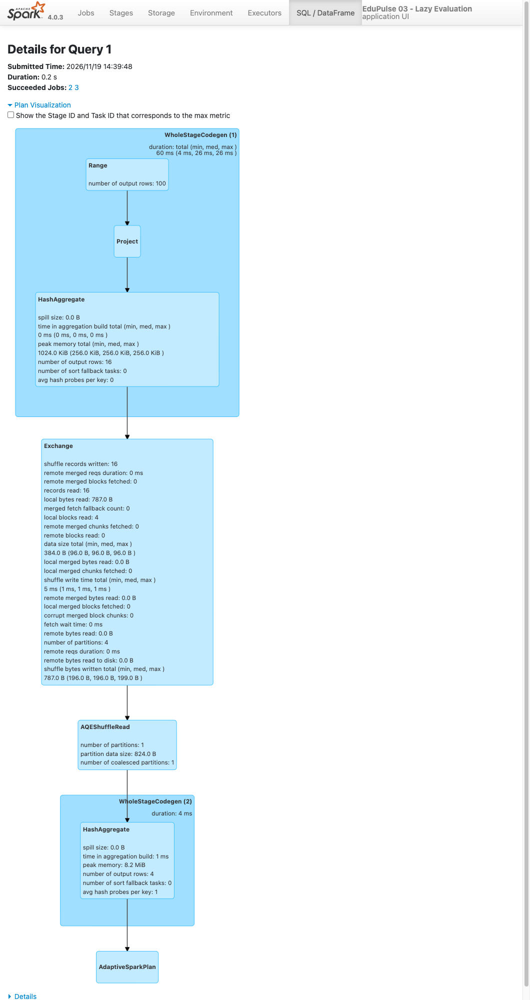

# Ghi chú Phase 1 · Spark Foundations

## Đếm sự kiện EdNet theo ngày

Bài 01 đọc cùng bộ EdNet KT3 từ JSON và CSV. Với cấu hình của bài, Spark suy luận `event_time` là `string` trong JSON và `timestamp` trong CSV. `metadata` là `struct` trong JSON và chuỗi trong CSV. Bài 02 đưa thời gian về ngày UTC rồi đối chiếu kết quả giữa Spark DataFrame, Spark SQL và Pandas.

| Ngày UTC | Số sự kiện |
|---|---:|
| 2019-04-08 | 1.332 |
| 2019-04-09 | 1.445 |
| 2019-04-10 | 1.451 |
| 2019-04-11 | 1.696 |
| 2019-04-12 | 1.611 |
| 2019-04-13 | 1.318 |
| 2019-04-14 | 1.147 |
| **Tổng** | **10.000** |

Pandas xử lý DataFrame trong tiến trình Python. PySpark gửi các biểu thức DataFrame cho Spark trên JVM. Spark chia dữ liệu thành các partition và có thể chạy các task trên nhiều máy. Với mẫu 10.000 dòng, cả hai đều chạy được trên máy cá nhân. Bài này dùng Pandas để kiểm tra kết quả và dùng Spark để quan sát kế hoạch và cách thực thi.

## Spark chạy một yêu cầu như thế nào

- **SparkSession** là điểm vào để đọc dữ liệu và dùng DataFrame hoặc SQL. **SparkContext** cung cấp thông tin về ứng dụng và các job đang được Spark theo dõi.
- **Driver** giữ kế hoạch và điều phối công việc. **Executor** chạy các task. Trên cluster, **cluster manager** cấp tài nguyên cho ứng dụng. Bài 03 dùng `local[2]`, cho phép tối đa hai task chạy đồng thời trên máy local.
- **Partition** là một phần dữ liệu. Một **task** xử lý một partition trong một **stage**. Spark lập một hay nhiều **job** để thực thi một action. Quan hệ phụ thuộc giữa các stage tạo thành một đồ thị có hướng, gọi là DAG.
- **Lazy evaluation** thể hiện khi `filter()` xây kế hoạch và tab Jobs vẫn trống. Các action như `show()`, `count()` trên DataFrame và `collect()` yêu cầu kết quả. `collect()` đưa kết quả về driver, nên bài 03 dùng nó với bảng tổng hợp chỉ có bốn dòng.
- **Logical plan** mô tả phép tính cần làm. **Physical plan** cho biết Spark chọn toán tử nào để chạy. `explain("extended")` cho xem cả hai, còn `explain("formatted")` giúp đọc từng toán tử.

## Đọc ảnh Spark UI của bài 03

1. **Đếm số chẵn.** `evens.count()` chạy phép lọc trên bốn partition. Các task đếm được `13 + 12 + 13 + 12`. Spark gộp các số đếm để trả về **50**.
2. **Đếm theo bucket.** `groupBy("bucket").count()` tạo kế hoạch và `collect()` yêu cầu Spark chạy. Mỗi bucket theo phần dư khi chia cho 4 có **25** số.
3. **Tìm shuffle.** Đọc sơ đồ từ `Range` xuống theo mũi tên. `HashAggregate` đầu tiên đếm cục bộ, tạo **16 số đếm** từ bốn bucket trong mỗi partition. `Exchange` ghi **787 byte** để chuyển các số đếm có cùng bucket về cùng partition. `HashAggregate` cuối cùng cộng các số đếm và trả **4 dòng**. Phép lọc từng partition là *narrow transformation*. Việc nhóm theo bucket cần dữ liệu từ nhiều partition, nên là *wide transformation*.

Trong tab **Stages**, xem **Shuffle Write** ở stage phát dữ liệu và **Shuffle Read** ở stage nhận dữ liệu. Với Adaptive Query Execution, Spark có thể gộp các partition nhỏ sau shuffle, nên một stage chạy sau shuffle có thể có ít task hơn số partition ban đầu. [Spark UI](https://spark.apache.org/docs/4.0.3/monitoring.html) · [Adaptive Query Execution](https://spark.apache.org/docs/4.0.3/sql-performance-tuning.html#adaptive-query-execution)
